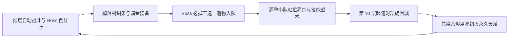

<div align="center">

# 余烬深渊 · Ember Abyss

零构建像素风地下城挂机 RPG——把暗黑词条刷宝、4 人像素小队羁绊与轻肉鸽轮回塞进一个打开浏览器即玩的 320×180 像素画布。

[](https://zhengqiuyang.github.io/pixel-idle-dungeon/)
[](package.json)
[](js/main.js)
[](vendor/pixelfx/LICENSE)

[快速开始](#quickstart) · [设计取舍](#why) · [核心循环](#how-it-works) · [实测体量](#proof) · [参考文档](#reference) · [当前边界](#limits)

</div>

<a id="quickstart"></a>

## 快速开始

直接打开在线试玩页：https://zhengqiuyang.github.io/pixel-idle-dungeon/

或者拉取到本地零构建启动（Windows 可直接双击 [play.bat](play.bat) 自动拉起服务并打开浏览器）：

```bash
git clone https://github.com/zhengqiuyang/pixel-idle-dungeon.git
cd pixel-idle-dungeon
python -m http.server 8021
```

启动后浏览器访问 `http://127.0.0.1:8021/` 即可开玩（ES Modules 需通过 HTTP 服务加载，不能用 `file://` 直接双击 `index.html`）。

> [!NOTE]
> 游戏每 5 秒自动写入浏览器 `localStorage`，支持最高 8 小时离线收益结算，并可在「典籍 → 设置」中导出 / 导入 Base64 存档文本。

<a id="why"></a>

## 为什么做它

很多挂机游戏后期只剩「挂机等数字膨胀」，而传统肉鸽死亡又会清空刷宝成果。《余烬深渊》把「局内肉鸽 + 局外刷宝 + 小队羁绊」分层融合，让离线挂机和上线构筑互不打架：

| 维度 | 传统数值挂机 | 传统硬核肉鸽 | 《余烬深渊》 |
|---|---|---|---|
| 后台挂机体验 | 自动刷怪但打法单一 | 必须全程手操，无法离线 | 三选一遗物与奇遇进队列不卡战斗 |
| 构筑与策略深度 | 堆叠平铺百分比 | 单人换武器或卡牌 | 12 暗金机制 + 7 副词条 + 5 组小队羁绊 |
| 轮回挫败感 | 转生清零一切重新熬 | 阵亡即丢当次全部装备 | 第 10 层起随时凯旋，装备与伙伴永久保留 |
| 部署与运行门槛 | 依赖框架或后端 | 客户端安装包或打包构建 | 原生 HTML/CSS/ESM，任意静态托管即玩 |

<a id="how-it-works"></a>

## 核心循环



<a id="proof"></a>

## 当前版本实测体量

以下数据均直接统计自当前仓库代码（[js/data.js](js/data.js)、[js/sprites.js](js/sprites.js)、[js/skills.js](js/skills.js)、[js/relics.js](js/relics.js)、[js/narrative.js](js/narrative.js)、[js/themes.js](js/themes.js)）：

| 维度 | 实装规模 | 代码出处 |
|---|---|---|
| 核心源码体量 | 11 个原生 JS 模块 + CSS/HTML 共 10,677 行 | [js/main.js](js/main.js) |
| 像素美术与场景 | 82 帧字符网格精灵 · 8 套主题地牢与视差行军 | [js/sprites.js](js/sprites.js) |
| 战斗特效 | 接入 23 个 `pixelfx` 像素粒子/数字/状态特效 | [vendor/pixelfx/README.md](vendor/pixelfx/README.md) |
| 暗黑刷宝词条 | 12 件独特机制传说暗金 · 7 种随机副词条 | [js/data.js](js/data.js) |
| 小队与构筑 | 3 项勇者战术技能 · 3 位伙伴 · 5 套小队羁绊 | [js/skills.js](js/skills.js) |
| 肉鸽与叙事内容 | 22 个遗物 · 8 项永久天赋 · 14 个奇遇 · 编年史 | [js/relics.js](js/relics.js) |

> [!TIP]
> 在仓库根目录运行 `node --check js/main.js`（或遍历 `js/*.js`）即可在无打包器环境下验证全部 ES Module 语法完整性。

<a id="reference"></a>

## 参考文档

<details>
<summary><b>目录结构与 11 个核心模块说明</b></summary>

| 文件 | 职责 |
|---|---|
| [index.html](index.html) / [css/style.css](css/style.css) | 主页面骨架、画布内嵌像素 HUD 浮层、5 标签面板与弹窗样式 |
| [js/main.js](js/main.js) | `requestAnimationFrame` 主循环、8 主题重着色与视差渲染、`pixelfx` 特效与交互 actions |
| [js/combat.js](js/combat.js) | 怪物生成、勇者与伙伴技能 AI、12 件暗金 hooks、滚动 10 秒分来源 DPS 统计 |
| [js/data.js](js/data.js) | 怪物成长曲线、装备与 7 种副词条、12 件传说暗金定义、离线效率估算 |
| [js/state.js](js/state.js) | v1→v2 存档自动迁移、属性派生、离线过滤结算、凯旋轮回与 Base64 导入导出 |
| [js/skills.js](js/skills.js) | 主勇者 3 技能、3 位伙伴（秘法使·薇拉 / 圣愈者·艾琳 / 影刃·凯）与 5 套羁绊 |
| [js/relics.js](js/relics.js) | 22 个肉鸽遗物（暴击 / 持续伤害 / 生存 / 经济）、三选一权重池与 8 项永久天赋 |
| [js/themes.js](js/themes.js) | 8 套地牢配色方案（荒废地窖→余烬王座）与装饰物分布 |
| [js/narrative.js](js/narrative.js) | 开场短诗、Boss 战前气泡台词、14 个奇遇事件、暗金风味文案与编年史里程碑 |
| [js/sprites.js](js/sprites.js) | Hue-Shifting 色板、`24×28` 勇者与伙伴、`36×40` Boss 与脚底接触投影绘制 |
| [js/ui.js](js/ui.js) / [js/audio.js](js/audio.js) | 顶栏/HUD/背包对比/过滤/三选一与奇遇弹窗、WebAudio 程序化合成音效 |

</details>

<details>
<summary><b>调试预览参数与伙伴解锁条件速查</b></summary>

* `?debug=party`：暂停战斗并在画布同屏预览 4 人小队站位与 Boss 模型
* `?debug=floor=N`：静态预览第 `N` 层对应的地牢主题配色与装饰物（每 5 层轮换）
* **秘法使·薇拉**：击杀任意深渊之主后花费 500 金币招募，主攻法术爆发与链式新星
* **圣愈者·艾琳**：消耗 10 灵魂余烬招募，负责治疗、护盾与净化毒蘑菇中毒
* **影刃·凯**：消耗 25 灵魂余烬招募，负责高频连击、叠层流血与 20% 血线以下斩杀

</details>

<details>
<summary><b>开源致谢与第三方许可</b></summary>

* 帧缓冲与粒子特效库来自内置的 `vendor/pixelfx`（MIT License），完整许可与版权声明见 [vendor/pixelfx/LICENSE](vendor/pixelfx/LICENSE) 与 [vendor/pixelfx/NOTICE.md](vendor/pixelfx/NOTICE.md)。

</details>

<a id="limits"></a>

## 当前边界与限制

> [!WARNING]
> 本项目为纯浏览器前端单机游戏，**不提供**后端账户系统、云存档同步、联机对战或全球排行榜。

* 存档仅保存在当前浏览器的 `localStorage`（key 为 `pixel-idle-dungeon-v1`），清理浏览器缓存或无痕窗口关闭后会丢失进度，换设备前请务必在「典籍 → 导出存档」手动备份。
* 全部角色与地牢像素图由 [js/sprites.js](js/sprites.js) 字符网格直接生成，无外部 PNG/SpriteSheet 美术资源管线。
* 仓库根目录暂未单独放置整库开源 `LICENSE` 文件；仅 `vendor/pixelfx/` 目录下附带其自身的 MIT 许可协议。
